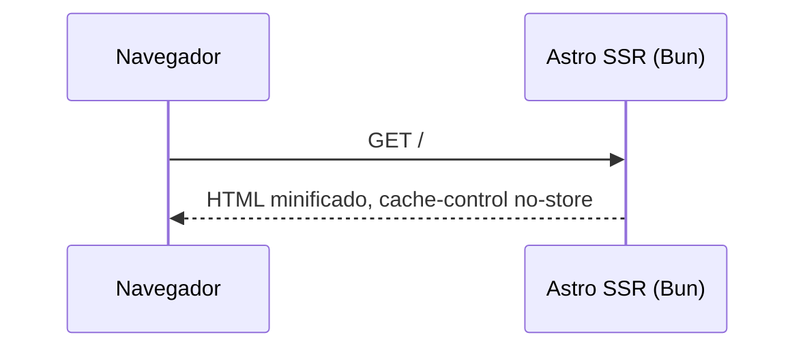

# Astro

[Astro](https://astro.build)
[Astro - Docs](https://docs.astro.build)
[Astro - MCP](https://mcp.docs.astro.build)

Astro SSR ajustado para produção no Bun: servidor standalone, HTML minificado, sem JavaScript no cliente. Use como base de configuração de um Astro que renderiza a cada requisição.

## MCP

**Instalar somente no projeto local:**

```bash
cd /path/project
claude mcp add --transport http --scope local astro-docs https://mcp.docs.astro.build/mcp
```

## Diagrama



## Cenário

Saldo da conta renderizado a cada acesso, fora de qualquer cache compartilhado.

## Como funciona

1. `astro.config.mjs`: `output: 'server'` com `@astrojs/node` standalone
2. `compressHTML`, CSS inline, sem origem de imagem remota, sem prefetch, `security.checkOrigin`, dev toolbar desligado, `vite.build` com alvo fixo, minificação e sem sourcemap
3. `bun --smol` sobe o build com heap menor
4. `docker.sh`: skeleton de `bun create astro` com config e `src` por cima, install, build e start no `docker run`; código montado só leitura e build num volume anônimo
5. Limites de memória, CPU e pids, usuário sem root, sistema de arquivos só leitura, telemetria desligada e healthcheck

## Executar

```sh
./docker.sh
until curl -sf localhost:4321 >/dev/null; do sleep 1; done
curl -si localhost:4321
docker rm -fv astro
```

Saída: `200` com `cache-control: no-store, private` e o HTML minificado com o saldo de R$ 13.858,82.

## Trade-offs

| Vantagem | Desvantagem |
|---|---|
| HTML pronto e minificado, sem JavaScript no cliente | Cada acesso renderiza no servidor |
| `--smol` reduz memória no container | GC mais frequente sob carga |
