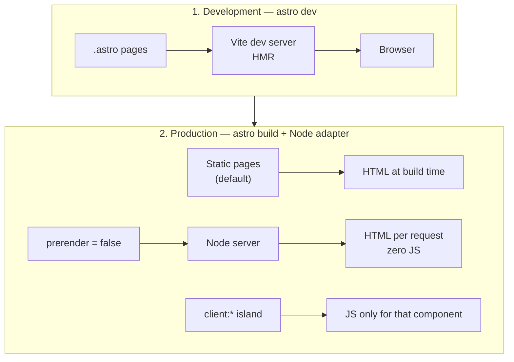

# Astro

- [Astro](https://astro.build)
- [Astro - Docs](https://docs.astro.build)
- [Astro - MCP](https://mcp.docs.astro.build)

## Uso

- Astro sempre última versão
- Estático por padrão; servidor só na página que muda a cada requisição
- Adapter Node standalone em produção
- Zero JavaScript no cliente; ilha só no componente interativo

## MCP

**Instalar somente no projeto local:**

```bash
cd /path/project
claude mcp add --transport http --scope local astro-docs https://mcp.docs.astro.build/mcp
```

## Diagrama



## Criar

```sh
npm create astro@latest
npx astro add node
```

## Página no servidor

```astro
---
// src/pages/saldo.astro: renderiza a cada requisição
import { balanceGet } from '../lib/balance';

export const prerender = false;

const balance = await balanceGet(Astro.cookies.get('session')?.value);
Astro.response.headers.set('cache-control', 'no-store, private');
---
<p>Saldo: {balance}</p>
```

```js
// astro.config.mjs
import { defineConfig } from 'astro/config';
import node from '@astrojs/node';

export default defineConfig({
  adapter: node({ mode: 'standalone' }),
});
```

## Como funciona

1. O frontmatter (`---`) roda só no servidor: acessa banco, cookie e segredo sem expor nada ao navegador
2. Sem `prerender = false`, a página vira HTML estático no build
3. Com `prerender = false`, o adapter Node renderiza a página a cada requisição
4. Componente com `client:*` vira ilha: só ele envia JavaScript

## Modos de renderização

| Modo | Diretiva | Renderiza | Exemplo |
|---|---|---|---|
| Estático | padrão | No build | Blog, docs, institucional |
| Sob demanda | `export const prerender = false` | A cada requisição | Saldo, área logada |
| Server island | `server:defer` | Depois do HTML, no servidor | Avatar, carrinho |
| Ilha cliente | `client:load`, `client:idle`, `client:visible` | No navegador | Formulário, carrossel |

## Produção

```sh
npm run build
HOST=0.0.0.0 PORT=4321 node ./dist/server/entry.mjs
```

## Boas práticas

- Comece estático; marque `prerender = false` só na página que precisa de dado por requisição
- Prefira `server:defer` a página inteira sob demanda quando só um trecho é dinâmico
- Use `client:visible` ou `client:idle` antes de `client:load`
- Envie `cache-control: no-store, private` em página com dado do usuário
- Estilize com Tailwind: `npx astro add tailwind`

## Trade-offs

| Vantagem | Desvantagem |
|---|---|
| HTML pronto, sem JavaScript no cliente | Interação exige ilha explícita |
| Estático e servidor no mesmo projeto | Página sob demanda exige servidor Node rodando |
