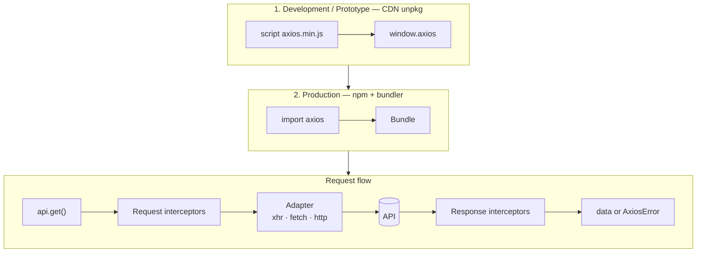

# Axios

- [Axios](https://axios-http.com)
- [Axios - Docs](https://axios-http.com/docs/intro)

## Uso

- Axios sempre última versão
- CDN (unpkg) em desenvolvimento e protótipo
- npm + bundler em produção
- Uma instância por API, com interceptors e timeout

## Diagrama



## Chamada

```html
<!doctype html>
<html lang="pt-BR">
<head>
  <meta charset="utf-8">
  <meta name="viewport" content="width=device-width, initial-scale=1">
  <script src="https://unpkg.com/axios@latest/dist/axios.min.js"></script>
</head>
<body>
  <p id="quote">...</p>
  <script>
    const api = axios.create({ baseURL: 'https://economia.awesomeapi.com.br/json', timeout: 5000 });

    api.get('/last/USD-BRL').then(({ data }) => {
      document.querySelector('#quote').textContent = `USD 1,00 = R$ ${data.USDBRL.bid}`;
    });
  </script>
</body>
</html>
```

## Produção

```sh
npm i axios
```

```ts
// src/lib/api.ts
import axios from 'axios';

export const api = axios.create({
  baseURL: import.meta.env.VITE_API_URL,
  timeout: 5000,
  headers: { Accept: 'application/json' },
});

api.interceptors.request.use((config) => {
  const token = sessionStorage.getItem('token');
  if (token) config.headers.Authorization = `Bearer ${token}`;
  return config;
});

api.interceptors.response.use(
  (response) => response,
  (error) => {
    if (axios.isAxiosError(error) && error.response?.status === 401) location.assign('/login');
    return Promise.reject(error);
  },
);
```

```ts
// src/lib/quote.ts
import axios from 'axios';
import { api } from './api';

type Quote = { USDBRL: { bid: string; create_date: string } };

export async function quoteGet(signal: AbortSignal) {
  try {
    const { data } = await api.get<Quote>('/last/USD-BRL', { signal });
    return data.USDBRL;
  } catch (error) {
    if (axios.isCancel(error)) return null;
    throw error;
  }
}
```

## Como funciona

1. `axios.create()` fixa `baseURL`, `timeout` e headers da API
2. Interceptor de request roda antes do envio: token, header, log
3. Adapter escolhe o transporte: `xhr` no navegador, `http` no Node; `adapter: 'fetch'` força o `fetch`
4. Interceptor de response roda na volta: trata 401, normaliza erro
5. Status fora de 2xx vira `AxiosError`; `signal` cancelado vira `CanceledError`
6. JSON entra e sai convertido: sem `JSON.stringify` nem `response.json()`

## Caminhos de desenvolvimento

| Caminho | Quando usar | Chamada |
|---|---|---|
| CDN unpkg | Desenvolvimento e protótipo | `<script src="https://unpkg.com/axios@latest/dist/axios.min.js">` |
| npm + Vite | Produção: Vite, Vue, React, Svelte | `npm i axios` |
| npm + Next.js / Astro | Produção: Server Component, página no servidor | `npm i axios` |
| npm + Node | Produção: backend, script, worker | `npm i axios` |

## Boas práticas

- `@latest` segue a versão mais recente; para travar, use a versão exata (`axios@1.20.0`)
- Use o CDN só em desenvolvimento: em produção, instale via npm e empacote no build
- Crie uma instância por API; nunca configure o `axios` global
- Defina `timeout` sempre: o padrão é `0`, sem limite
- Passe `signal` de um `AbortController` para cancelar busca repetida ou tela desmontada
- Tipe a resposta: `api.get<Quote>()`
- Guarde `baseURL` em variável de ambiente, nunca fixa no código

## Trade-offs

| Caminho | Vantagem | Desvantagem |
|---|---|---|
| CDN | Zero instalação, resultado imediato | Script externo bloqueante, sem tipagem |
| npm | Tipado, empacotado e versionado no lock | Soma ~23 KB gzip ao bundle; `fetch` nativo não pesa nada |
