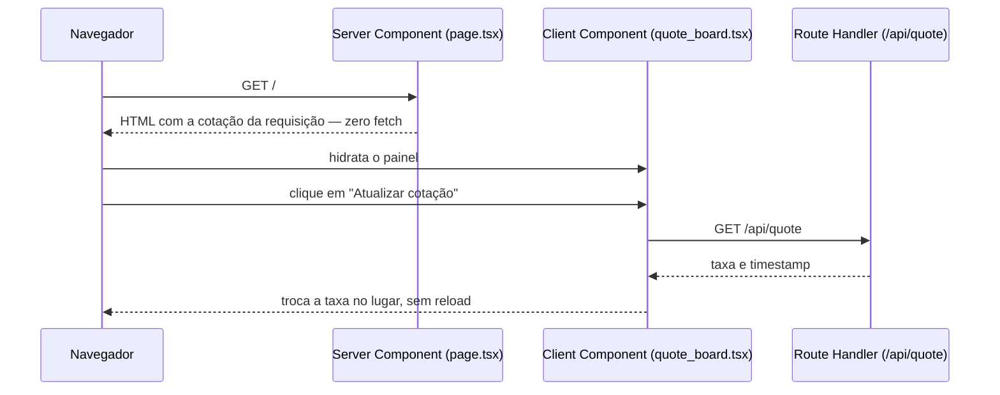

# Next.js App Router — Server Component, Client Component e Route Handler

Fronteira entre o que roda no servidor e no navegador no App Router, e o Route Handler que liga os dois sem recarregar a página.

## Diagrama



## Cenário

Cotação do dólar para remessa: a primeira vem pronta do servidor; o botão pede a seguinte ao Route Handler; em falha, a última válida fica na tela com aviso.

## Como funciona

1. `app/page.tsx` (Server Component): `await connection()` impede o prerender e `quoteUsdBrl()` precifica por requisição; a cotação vai como prop serializável
2. `app/quote_board.tsx` com `"use client"` é o único JavaScript no navegador; o clique chama `fetch("/api/quote", { cache: "no-store" })` e, em erro, mantém a última cotação com `role="alert"`
3. `app/api/quote/route.ts` responde `Response.json()` com `cache-control: no-store`
4. `next.config.mjs`: `output: "standalone"`, `compress`, sem `x-powered-by`, sem sourcemap no navegador, cache em memória de 32 MB, imagens AVIF e WebP sem origem remota; `browserslist` fixa o alvo
5. `docker.sh`: skeleton de `create-next-app` com os arquivos do project por cima, `next build` e `node .next/standalone/server.js` no `docker run`; código só leitura e build num volume anônimo
6. Heap de 512 MB, 2 threads do libuv com `--cpus 2`, telemetria desligada, host, porta e keepalive por `-e`, usuário sem root e sistema de arquivos só leitura

## Executar

```sh
./docker.sh
until curl -sf localhost:3000/api/quote >/dev/null; do sleep 1; done
curl -si localhost:3000/api/quote
curl -s localhost:3000 | grep -o 'Cotação do dólar para remessa'
docker rm -fv next-app-router
```

Saída: `200` com `cache-control: no-store` e a taxa com o horário da cotação; o HTML da página já traz o painel com a cotação.

## Trade-offs

| Vantagem | Desvantagem |
|---|---|
| Server Component entrega a cotação no HTML; só o painel envia JavaScript | Fronteira servidor/cliente exige props serializáveis e `"use client"` explícito |
| Route Handler atualiza a cotação sem recarregar a página | `connection()` e `no-store` desligam prerender e cache: toda requisição chega ao servidor |
