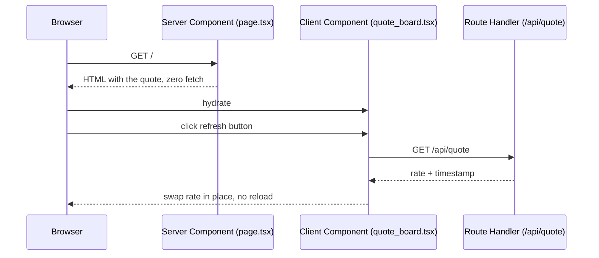

# Next.js

- [Next.js](https://nextjs.org)
- [Next.js - Docs](https://nextjs.org/docs)

## Uso

- Next.js sempre última versão, App Router
- Server Component por padrão; `"use client"` só no componente interativo
- Route Handler para dado sob demanda, sem recarregar a página
- `output: "standalone"` em produção

## Diagrama



## Criar

```sh
npx create-next-app@latest
```

## Código

```tsx
// app/page.tsx: Server Component, roda só no servidor
import { connection } from "next/server";
import { quoteUsdBrl } from "@/lib/quote_fx";
import QuoteBoard from "./quote_board";

export default async function Page() {
  await connection();
  return <QuoteBoard initialQuote={quoteUsdBrl()} />;
}
```

```tsx
// app/quote_board.tsx: Client Component, único JavaScript no navegador
"use client";

import { useState } from "react";
import type { QuoteFx } from "@/lib/quote_fx";

export default function QuoteBoard({ initialQuote }: { initialQuote: QuoteFx }) {
  const [quote, setQuote] = useState(initialQuote);

  async function quoteRefresh() {
    const response = await fetch("/api/quote", { cache: "no-store" });
    if (response.ok) setQuote(await response.json());
  }

  return <button onClick={quoteRefresh}>USD 1,00 = R$ {quote.rate}</button>;
}
```

```ts
// app/api/quote/route.ts: Route Handler
import { quoteUsdBrl } from "@/lib/quote_fx";

export function GET() {
  return Response.json(quoteUsdBrl(), { headers: { "cache-control": "no-store" } });
}
```

## Como funciona

1. Todo componente em `app/` é Server Component: roda no servidor e não envia JavaScript
2. `await connection()` impede o prerender: a página renderiza a cada requisição
3. `"use client"` marca a fronteira: o componente e seus imports viram JavaScript no navegador
4. Prop do servidor para o cliente precisa ser serializável
5. `route.ts` responde HTTP direto, sem página

## Onde roda

| Arquivo | Roda em | Use para |
|---|---|---|
| `page.tsx`, `layout.tsx` | Servidor | Dado, segredo, banco, HTML inicial |
| `"use client"` | Navegador (e servidor no 1º HTML) | Estado, evento, API do navegador |
| `route.ts` | Servidor | Endpoint HTTP, webhook, JSON |

## Produção

```js
// next.config.mjs
export default { output: "standalone", poweredByHeader: false };
```

```sh
npm run build
cp -r public .next/standalone/ && cp -r .next/static .next/standalone/.next/
node .next/standalone/server.js
```

## Boas práticas

- Busque dado no Server Component; passe ao cliente só o necessário
- Desça o `"use client"` até a folha da árvore: menos JavaScript no navegador
- Use `connection()` só quando o dado muda por requisição; o resto fica estático
- Envie `cache-control: no-store` em Route Handler com dado volátil
- Estilize com Tailwind via PostCSS: `create-next-app` já oferece a opção

## Trade-offs

| Vantagem | Desvantagem |
|---|---|
| HTML pronto no servidor; só o interativo envia JavaScript | Fronteira servidor/cliente exige props serializáveis |
| Página e API no mesmo projeto | Página dinâmica exige servidor Node rodando |
