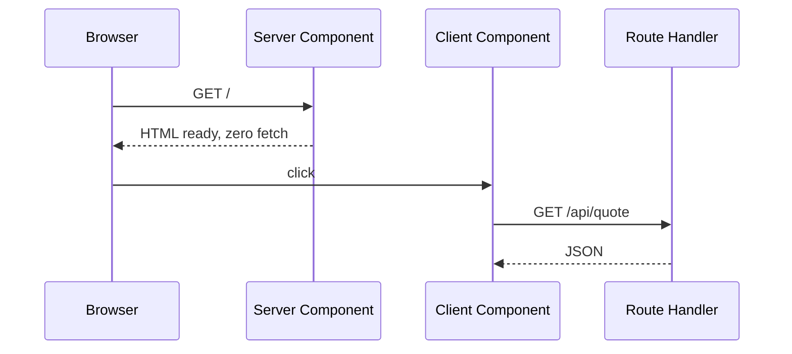

# Next.js

- [Next.js](https://nextjs.org)
- [Next.js - Docs](https://nextjs.org/docs)

## Uso

- Next.js sempre na última versão, App Router
- Server Component por padrão; `"use client"` só no componente interativo
- Route Handler para dado sob demanda

## Diagrama



## Criar

```sh
npx create-next-app@latest
```

## Código

```tsx
// app/page.tsx
import Quote from "./quote";

export default function Page() {
  return <Quote rate={5.42} />;
}
```

```tsx
// app/quote.tsx
"use client";

import { useState } from "react";

export default function Quote({ rate }: { rate: number }) {
  const [value, setValue] = useState(rate);
  const refresh = async () => setValue((await (await fetch("/api/quote")).json()).rate);
  return <button onClick={refresh}>USD 1,00 = R$ {value}</button>;
}
```

```ts
// app/api/quote/route.ts
export function GET() {
  return Response.json({ rate: 5.42 });
}
```

## Como funciona

1. `page.tsx` é Server Component: roda no servidor e não envia JavaScript
2. `"use client"` marca a fronteira: só `quote.tsx` vira JavaScript no navegador
3. `route.ts` responde HTTP direto, sem página

## Produção

```sh
npm run build
npm run start
```

## Boas práticas

- Busque dado no Server Component; passe ao cliente só o necessário
- Desça o `"use client"` até a folha da árvore
- Prop do servidor para o cliente precisa ser serializável

## Trade-offs

| Vantagem | Desvantagem |
|---|---|
| HTML pronto no servidor; só o interativo envia JavaScript | Fronteira servidor/cliente exige atenção |
| Página e API no mesmo projeto | Página dinâmica exige servidor Node rodando |
