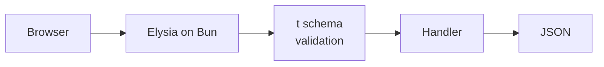

# Elysia

- [Elysia](https://elysiajs.com)
- [Elysia - Docs](https://elysiajs.com/at-glance.html)

## Uso

- Elysia sempre última versão, no Bun
- Validação com `t`: tipo e runtime no mesmo schema
- Binário único em produção

## Diagrama



## Criar

```sh
bun create elysia app
cd app && bun dev
```

## Código

```ts
// src/index.ts
import { Elysia, t } from 'elysia';

new Elysia()
  .get('/quote', () => ({ rate: 5.42 }))
  .post('/pix', ({ body }) => ({ ok: true, amount: body.amount }), {
    body: t.Object({ amount: t.Number({ minimum: 0.01 }) }),
  })
  .listen(3000);
```

## Produção

```sh
bun build --compile --minify src/index.ts --outfile server
./server
```

## Trade-offs

| Vantagem | Desvantagem |
|---|---|
| Rápido, tipado de ponta a ponta | Feito para Bun; Node exige adapter |
