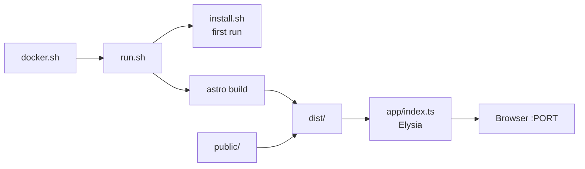

# Public

- [Elysia](https://elysiajs.com)
- [Elysia - Docs](https://elysiajs.com/at-glance.html)
- [Astro](https://astro.build)

## Uso

- Elysia no Bun serve o build estático do Astro
- `dist/` e `public/` servidos na raiz `/`
- CORS liberado e `/health` para checagem
- Container `oven/bun` configurado por `.env`

## Diagrama



## Estrutura

| Arquivo | Função |
|---|---|
| `app/index.ts` | Servidor Elysia: CORS `*`, `/health`, `/` e estáticos de `dist/` e `public/` |
| `install.sh` | `bun init` e dependências de Elysia e Astro |
| `run.sh` | Instala se faltar, roda `astro build`, copia `public/` para `dist/` e sobe o servidor |
| `docker.sh` | Lê `.env` e recria o container `GROUP_PROJECT` em `oven/bun:1.4.2-alpine` |

## .env

```sh
GROUP=front
PROJECT=public
PORT=3000
```

## Executar

```sh
./docker.sh
curl localhost:3000/health
```

Sem Docker: `sh run.sh`.

## Rotas

| Rota | Resposta |
|---|---|
| `GET /health` | `ok` |
| `GET /` | `dist/index.html` |
| `GET /*` | Arquivo de `dist/` ou `public/` |
