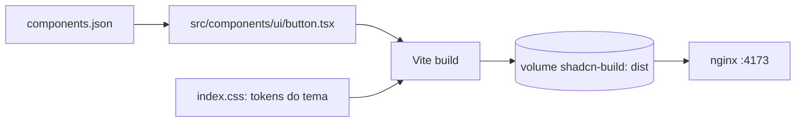

# Shadcn

Componente shadcn em Vite + React + Tailwind, com build de produção ajustado e servido como estático. Use como base de configuração de um projeto shadcn.

## Diagrama



## Cenário

Botão de confirmação de PIX com o tema do shadcn.

## Como funciona

1. `components.json`: estilo, aliases e CSS do tema que o CLI do shadcn usa; `button.tsx` copiado do shadcn e reduzido às variantes em uso
2. `index.css`: só os tokens que o componente usa, `source("./")` restrito a `src`
3. `vite.config.ts`: Tailwind como plugin, `build.target` fixo, JS e CSS minificados, sem sourcemap e sem polyfill de preload
4. Build: skeleton de `bun create vite` com os arquivos do project por cima, código só leitura e `dist` no volume `shadcn-build`
5. Servidor: Vite não tem servidor de produção; nginx serve o `dist` só leitura, `/assets/` imutável por um ano, HTML com `no-cache`, gzip e host e porta por `-e`
6. Limites de memória, CPU e pids, build sem root, sistema de arquivos só leitura e healthcheck

## Executar

```sh
./docker.sh
until curl -sf localhost:4173 >/dev/null; do sleep 1; done
curl -si localhost:4173
curl -sI "localhost:4173$(curl -s localhost:4173 | grep -o '/assets/[^"]*\.js')"
docker rm -f shadcn && docker volume rm shadcn-build
```

Saída: o HTML com `cache-control: no-cache` e o asset JS com `cache-control: public, max-age=31536000, immutable`.

## Trade-offs

| Vantagem | Desvantagem |
|---|---|
| Código do componente no projeto, sem dependência de UI | Atualização do shadcn é manual |
| CSS só com os tokens usados; assets com hash em cache imutável | Componente novo exige novos tokens |
