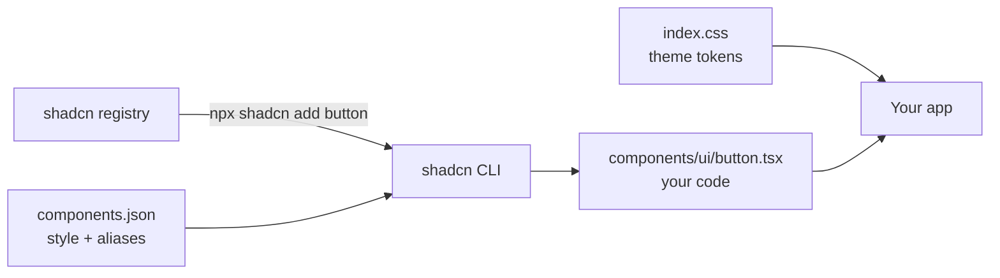

# shadcn/ui

- [shadcn/ui](https://ui.shadcn.com)
- [shadcn/ui - Docs](https://ui.shadcn.com/docs)

## Uso

- shadcn sempre última versão (`shadcn@latest`)
- Não é dependência: o CLI copia o código do componente para o projeto
- Exige React + Tailwind

## Diagrama



## Criar

```sh
npx shadcn@latest init -t vite
```

Template: `next`, `vite` ou `astro`. Em projeto existente: `npx shadcn@latest init`.

## Adicionar componente

```sh
npx shadcn@latest add button
```

```tsx
import { Button } from "@/components/ui/button";

<Button>Confirmar PIX de R$ 1.250,00</Button>
```

## Como funciona

1. `init` cria `components.json`, `lib/utils.ts` e os tokens do tema no CSS
2. `add` copia o componente do registry para `components/ui/`
3. O componente é seu: edite direto no arquivo

## Boas práticas

- Adicione só o componente em uso
- Customize pelos tokens do tema (`--primary`, `--ring`) antes de editar o componente
- Rode `npx shadcn@latest add button --diff` antes de sobrescrever

## Trade-offs

| Vantagem | Desvantagem |
|---|---|
| Código no projeto, sem dependência de UI | Atualização é manual, componente a componente |
| Total controle de estilo e comportamento | Exige React + Tailwind; sem CDN |
