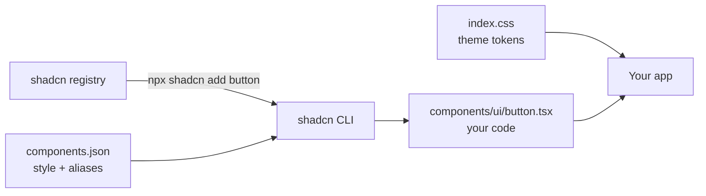

# shadcn/ui

- [shadcn/ui](https://ui.shadcn.com)
- [shadcn/ui - Docs](https://ui.shadcn.com/docs)

## Uso

- shadcn sempre última versão (`shadcn@latest`)
- Não é dependência: o CLI copia o código do componente para o projeto
- Tailwind v4 obrigatório; tema por variáveis CSS
- Funciona em Next.js, Vite, Astro, React Router e TanStack Start

## Diagrama



## Criar

```sh
npx shadcn@latest init -t vite
```

Template: `next`, `vite`, `astro`, `react-router` ou `start`. Em projeto existente: `npx shadcn@latest init`.

## Adicionar componente

```sh
npx shadcn@latest add button
```

```tsx
import { Button } from "@/components/ui/button";

<Button>Confirmar PIX de R$ 1.250,00</Button>
```

## Como funciona

1. `init` cria `components.json`, `lib/utils.ts` (`cn`) e os tokens do tema no CSS
2. `add` baixa o componente do registry e grava em `components/ui/`
3. O componente é seu: edite variantes, estilo e comportamento direto no arquivo
4. Variantes com `class-variance-authority`; classes mescladas por `cn` (`clsx` + `tailwind-merge`)

## components.json

| Campo | Define |
|---|---|
| `style` | Estilo visual dos componentes (`new-york`) |
| `rsc` | `true` em Next.js: adiciona `"use client"` onde precisa |
| `tailwind.css` | Arquivo CSS com os tokens do tema |
| `tailwind.baseColor` | Paleta base: `neutral`, `zinc`, `slate`… |
| `aliases` | Caminhos de `components`, `ui`, `lib`, `hooks` |
| `iconLibrary` | Ícones usados pelos componentes (`lucide`) |

## Boas práticas

- Adicione só o componente em uso; não copie a biblioteca inteira
- Customize pelos tokens do tema (`--primary`, `--ring`) antes de editar o componente
- Versione `components/ui/` como código seu: revise o diff ao rodar `add` de novo
- Use `npx shadcn@latest add button --diff` para ver o que mudou no registry antes de sobrescrever

## Trade-offs

| Vantagem | Desvantagem |
|---|---|
| Código no projeto, sem dependência de UI | Atualização é manual, componente a componente |
| Total controle de estilo e comportamento | Exige React + Tailwind; sem CDN |
