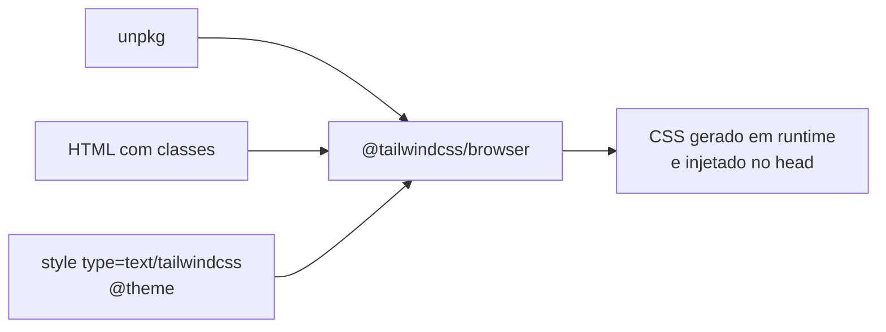

# Tailwind

[Site](https://tailwindcss.com) · [Documentação](https://tailwindcss.com/docs) · [CDN no navegador](https://tailwindcss.com/docs/installation/play-cdn)

Tailwind v4 carregado por CDN (unpkg): sem instalação, sem build.

## Diagrama



## Chamada

```html
<!doctype html>
<html lang="pt-BR">
<head>
  <meta charset="utf-8">
  <meta name="viewport" content="width=device-width, initial-scale=1">
  <script src="https://unpkg.com/@tailwindcss/browser@latest"></script>
  <style type="text/tailwindcss">
    @theme {
      --color-ink: #0f172a;
      --color-credit: #15803d;
      --color-debit: #b91c1c;
    }
  </style>
</head>
<body class="font-sans p-6 text-ink">
  <h1 class="text-2xl">Extrato</h1>
  <p class="text-sm text-credit">+ R$ 1.200,00</p>
  <p class="text-sm text-debit">− R$ 340,00</p>
</body>
</html>
```

## Como funciona

1. `@tailwindcss/browser` lê as classes do DOM e gera o CSS no navegador
2. `MutationObserver` regenera o CSS a cada classe nova
3. `<style type="text/tailwindcss">` aceita `@theme`, `@utility`, `@variant` e `@apply`
4. `@theme` cria os tokens: `--color-credit` vira `text-credit`, `bg-credit`, `border-credit`

## Boas práticas

- `@latest` segue a versão mais recente; para travar, use a versão exata (`@4.3.3`)
- Declare tokens semânticos em `@theme` (`credit`, `debit`), não cores soltas (`#15803d`)
- Feche o tema com `--*: initial` dentro de `@theme` para gerar só os tokens declarados

## Trade-offs

| Vantagem | Desvantagem |
|---|---|
| Zero instalação, resultado imediato | JS no navegador, CSS em runtime, flash sem estilo |
