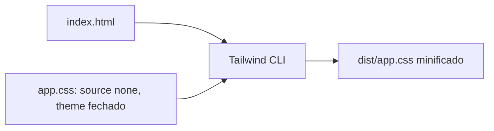

# Tailwind

Build do Tailwind CLI com detecção automática desligada e tema fechado: o CSS final só tem o que a página usa. Use como base de configuração do Tailwind em qualquer projeto.

## Diagrama



## Como funciona

1. `@import "tailwindcss" source(none)` desliga a varredura automática
2. `@source` aponta só para `index.html`
3. `@theme` com `--*: initial` zera o tema padrão e define só os tokens do extrato
4. `--minify` no build
5. `docker.sh` roda o build em container descartável, com código só leitura e saída em `--tmpfs`, e mostra o tamanho do CSS e as classes geradas

## Executar

```sh
./docker.sh
```

Saída: o tamanho de `dist/app.css` em bytes e só as classes de `index.html`: `font-sans`, `p-6`, `text-2xl`, `text-credit`, `text-debit`, `text-ink` e `text-sm`.

## Trade-offs

| Vantagem | Desvantagem |
|---|---|
| CSS mínimo e previsível | Classe fora do `@source` não é gerada |
| Tema fechado evita token sem uso | Todo token novo precisa ser declarado |
