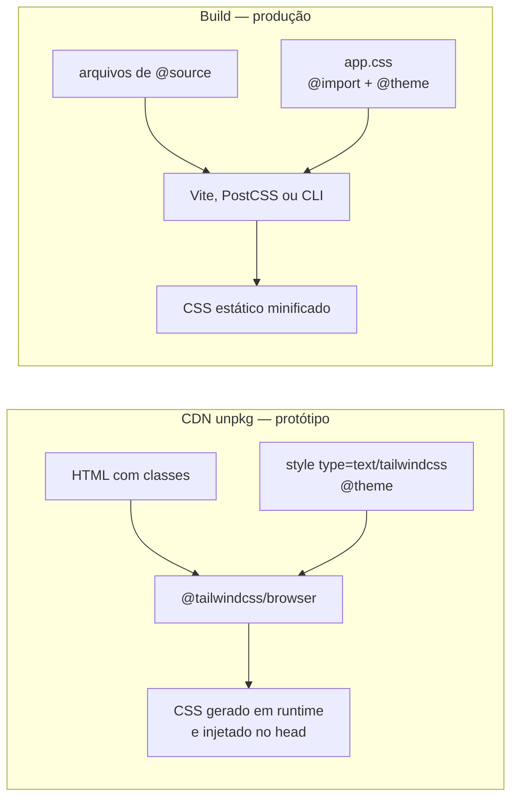

# Tailwind

[Site](https://tailwindcss.com) · [Documentação](https://tailwindcss.com/docs) · [CDN no navegador](https://tailwindcss.com/docs/installation/play-cdn)

Tailwind v4 carregado por CDN (unpkg) para estudo e protótipo, e o caminho de build para produção.

## Diagrama



## Chamada

```html
<!doctype html>
<html lang="pt-BR">
<head>
  <meta charset="utf-8">
  <meta name="viewport" content="width=device-width, initial-scale=1">
  <script src="https://unpkg.com/@tailwindcss/browser@latest"></script>
  <style type="text/tailwindcss">
    @theme {
      --color-ink: #0f172a;
      --color-credit: #15803d;
      --color-debit: #b91c1c;
    }
  </style>
</head>
<body class="font-sans p-6 text-ink">
  <h1 class="text-2xl">Extrato</h1>
  <p class="text-sm text-credit">+ R$ 1.200,00</p>
  <p class="text-sm text-debit">− R$ 340,00</p>
</body>
</html>
```

## Como funciona

1. `@tailwindcss/browser` lê as classes do DOM e gera o CSS no navegador
2. `MutationObserver` regenera o CSS a cada classe nova
3. `<style type="text/tailwindcss">` aceita `@theme`, `@utility`, `@variant` e `@apply`
4. `@theme` cria os tokens: `--color-credit` vira `text-credit`, `bg-credit`, `border-credit`

## Caminhos de desenvolvimento

| Caminho | Quando usar | Chamada |
|---|---|---|
| CDN unpkg | Estudo, protótipo, demo | `<script src="https://unpkg.com/@tailwindcss/browser@latest">` |
| Vite | React, Vue, Svelte, Astro com Vite | `npm i tailwindcss @tailwindcss/vite` |
| PostCSS | Next.js, webpack | `npm i tailwindcss @tailwindcss/postcss` |
| CLI | Site estático sem bundler | `npx @tailwindcss/cli -i app.css -o dist/app.css --minify` |

## Boas práticas

- `@latest` segue a versão mais recente; para travar, use a versão exata (`@4.3.3`)
- Use o CDN só em desenvolvimento: em produção, gere CSS estático no build
- Declare tokens semânticos em `@theme` (`credit`, `debit`), não cores soltas (`#15803d`)
- Escreva a classe inteira no código: `text-${cor}` não é detectado no build
- No build, use `@import "tailwindcss" source(none)` e `@source` para limitar a varredura
- Feche o tema com `--*: initial` dentro de `@theme` para gerar só os tokens declarados

## Trade-offs

| Caminho | Vantagem | Desvantagem |
|---|---|---|
| CDN | Zero instalação, resultado imediato | JS no navegador, CSS em runtime, flash sem estilo |
| Build | CSS mínimo, estático e cacheável | Exige toolchain; classe fora do `@source` não é gerada |
